# SIEM Detection Lab: Security Onion with Windows Endpoint Telemetry

A network-security coursework project in which I built a small SOC-style monitoring lab, attacked it from Kali Linux, and checked what the SIEM detected. The full write-up, with screenshots, follows the summary.

> Lab only. Every scan and attack in this project was run against virtual machines I built for the purpose, on a private network (RFC 1918 addresses).

## At a glance

| | |
|---|---|
| SIEM platform | Security Onion 2.4.160 (Elasticsearch, Logstash, Kibana, Suricata, Zeek) on VMware |
| Endpoint monitoring | Windows host running Sysmon and Winlogbeat 8.15.0, shipping events to Security Onion over SSL |
| Target | Ubuntu server running Apache httpd 2.4.63 |
| Attacker | Kali Linux (Nmap, Nikto) |
| Data volume | 618,057 security events indexed |
| Alerts | 1,135 alerts in the Security Onion Alerts view |

## What I did

1. Deployed Security Onion on a dedicated VMware virtual machine, with separate management and monitoring network interfaces.
2. Onboarded a Windows endpoint: installed Sysmon, configured Winlogbeat to forward Windows security and Sysmon events over SSL, and verified the event flow with PowerShell.
3. Built an Apache web target on Ubuntu and a Kali Linux attacker, and confirmed connectivity between all hosts.
4. Ran network discovery, service enumeration and web scanning (Nmap, Nikto), plus a SYN scan against the Windows host.
5. Reviewed what the SIEM caught using the Alerts, Dashboards, Hunt and Cases views.

## Results

- Alerts were grouped by category, including cross-site scripting (266), directory traversal (179), command injection (66), XML external entity (41) and Kali Linux reconnaissance (31).
- Suricata produced 61,127 network detections across the run, and the Hunt view allowed searching across more than 120,000 events.
- The Windows host's firewall blocked the unauthorised scan attempts while legitimate connections kept working.

## Scope and limitations

- The numbers come from a short lab run against default-configured targets. They show that the detection pipeline works end to end, not how it would perform on real production traffic.
- The write-up covers Security Onion's built-in detections. Custom Suricata or correlation rules, and user and entity behaviour analytics, are listed as future work.
- Early networking problems (link-local addressing on the Ubuntu VM) and how I fixed them are documented in the challenges section.

## Full write-up

## 1.0 Introduction 

### 1.1 Network Security and SIEM Overview

Human can’t deny that network security has become a really critical concern for organizations worldwide as the cyber threats continue to evolve in a sophisticated way and the frequency of it. Through the utilization of SIEM alerting and incident response processes and Security Orchestration, Automation, and Response (SOAR) tools to enable fast-response-time and threat-containment. Based on the recent industry report, cybercrime damages are projected to roughly 10.5 trillion dollars annually by 2025 and making a robust security monitoring systems to be more essential for organization to survive (Manzoor et al., 2024).

Therefore, the security information and event management that is SIEM is one of the foundations on which this technology can be considered as a current cybersecurity framework. In fact, SIEM give a centralized accumulation, integration and exploration of security events on numerous sources all through the IT infrastructure of an organization. This approach allows the security teams to detect threats in real time, investigate incident more efficiently and preserve compliance with regulatory requirements (Granadillo et al., 2021).

### 1.2 Current Barrier in Network Security

The current threats landscape presents some challenges that necessitate advanced SIEM implementation like Advanced Persistent Threats known as APTs. Nation state actors and complex criminal organizations deploy multi stages of attack that can still remain undetected for several months. These threats ask for comprehensive monitoring and correlation capabilities that traditional security tools can’t fulfil (Md. Alamin Talukder et al., 2024). Secondly, as organizations migrate into hybrid mode and multiple cloud environments, the traditional perimeter security models will eventually to be insufficient. SIEM systems must adapt to monitor distributed architecture and provide their visibility across on premises and cloud resources (Esra Altulaihan et al., 2024). Malicious or unintentional actions that insider threats are typically fond of tend to pose a high degree of a risk profile that needs behavioural analysis and user activity monitoring capabilities that are ingrained in most modern SIEM platforms (Mohammad et al., 2024). While compliance requirements are the regulations like GDPR, HIPAA and SOX authorize extensive logging and monitoring capabilities by enable SIEM to apply a business necessity instead of just a security enhancement (TekClarion Admin, 2025) .

## 2.0 Selected Focus Area

### 2.1 Intrusion Detection Systems (SIEM)

The security Information and Event Management which is SIEM as the focus area for this research and implementation especially applying the Security Onion as an open source SIEM platform that integrates the ELS stack which including Elasticsearch, Logstash and Kibana for the panoramic network security monitoring.

### 2.2 SIEM Technology Overview 

The fact is that SIEM technology actually integrates three most important features which are significant in contemporary cybersecurity operations such as Security Information Management or SIM. It is a long term analysis and storage of log data to be used in compliance and forensic investigations purposes by enabling organizations to keep a historical record of security events in a log file that can assist it to comply with regulation (Granadillo et al., 2021). Coupled with this, Security Event Management or SEM can also be used as a real time implementation of monitoring and analysis security events in order to form an immediate response to threats by performing the fast detection facility that modern threats demand of them (Md. Alamin Talukder et al., 2024). Security Event Correlation is next, and this is SEC act as an advanced analytics which identifies patterns and relationships between two or more data sources and so detection of cosmopolitan attacks are identified which can escape it sometimes scrutiny by single source analytics (Hore et al., 2024).

### 2.3 Why Network Security need SIEM 

Modern networks generate massive volumes of log data especially from firewalls, intrusion detection systems, servers, applications and endpoints. Not having this centralized gathering and smart analysis, the security team will find it unable to detect threats as well as even react to incidents. Given that there is a solution to this challenge that requires SIEM platforms to group log data of various sources that can be viewed in a central repository to enable comprehensive visibility. It standardizes various log formats to get similar analysis in heterogeneous setup and uses related rules to find attacks that take place in various systems. The real time alerting will provide the alerting of the critical security events that require prompt response and will facilitate swift investigation of the incident along with the analyses of the forensics via the centralized search features.

## 3.0 Tools and Strategies Implementation

### 3.1 Security Onion Architecture

Security Onion supply exhaustive SIEM solution incorporating multiple open source security tools to optimize the network security monitoring while using Elasticsearch. The distributed search and analytics engine that stores and indexes security data by allowing rapid search across massive datasets with sub second response times for threat hunting activities. While using the Logstash, the data processing pipeline that takes a variety of sources, transforms it, and passes to the Elasticsearch, with all the data normalization and enrichment capabilities required to achieve effective correlations. Logstash, as reflected in Figure 4, is a background service (PID 94026) that can flawlessly operate with the entire Security Onion infrastructure. Additionally, process verification of working Logstash service (PID 94026) combined with Elasticsearch, Kibana, Suricata and Zeek components that prove the full implementation of ELK stack SIEM by means of process monitoring system wide. Other than this, Suricata is also referred to as tool of network intrusion detection system which is NIDS capable of catching up network traffic and patterns that are malicious and thus creating some alerts according to both signature detection as well as anomaly based methods. Last but not least, Zeek which is officially Bro now for network security monitoring platforms also that can provide deeper detailed network traffic analysis and protocol level insights by enabling deep packet inspection and network forensics capabilities.

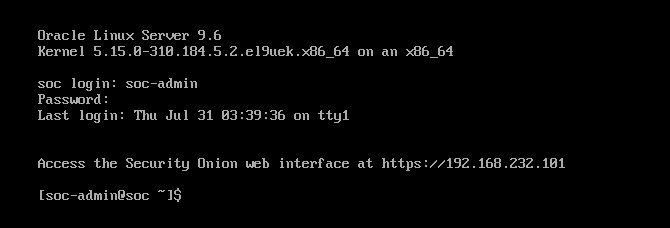

*Figure 3.1.1 : Security Onion Console Login - Shows Oracle Linux Server*

Security Onion System Access - console sign in displaying Oracle Linux Server 9.6 platform and web based application access at http://192.168.232.101.

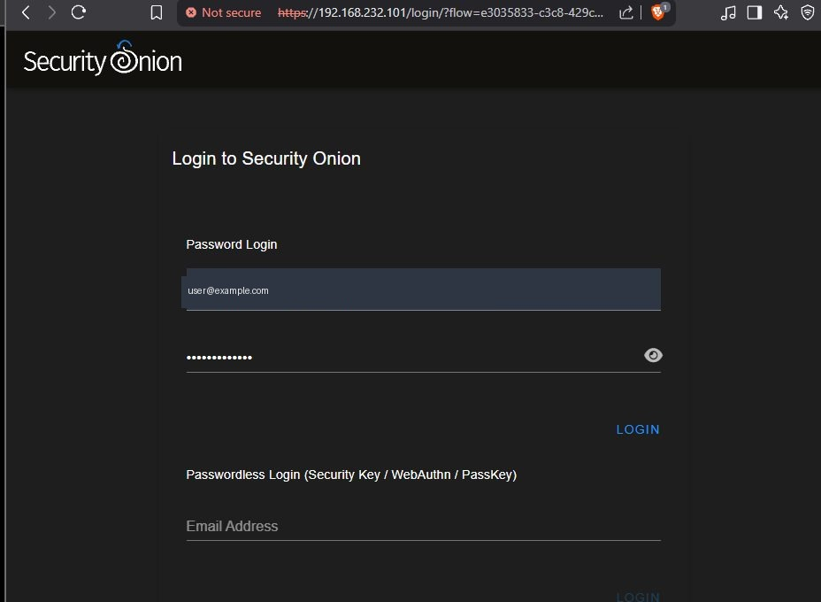

*Figure 3.1.2 : : Security Onion Web Login Interface*

Security Onion Web Interface - Authentication portal which shows that security access controls are implemented to manage a SIEM platform. The email and password will be the one which already set up during the Security Onion configuration.

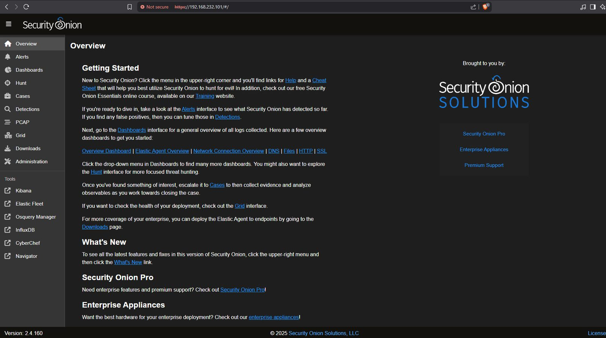

*Figure 3.1.3 : Security Onion Overview Dashboard*

Overview interface with SIEM capability indication of Alerts, Dashboards, Hunt and Cases management.

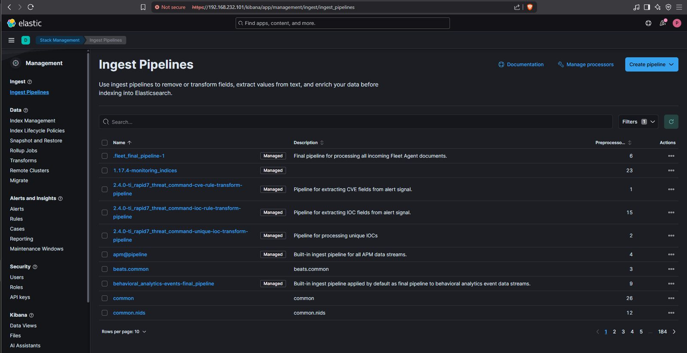

*Figure 3.1.4 : Elasticsearch Ingest Pipelines*

Elasticsearch Ingest Pipelines UI that showcases the ability of data transformation and processing with the Logstash integration of various pipeline processors, giving a detailed analysis of logs.

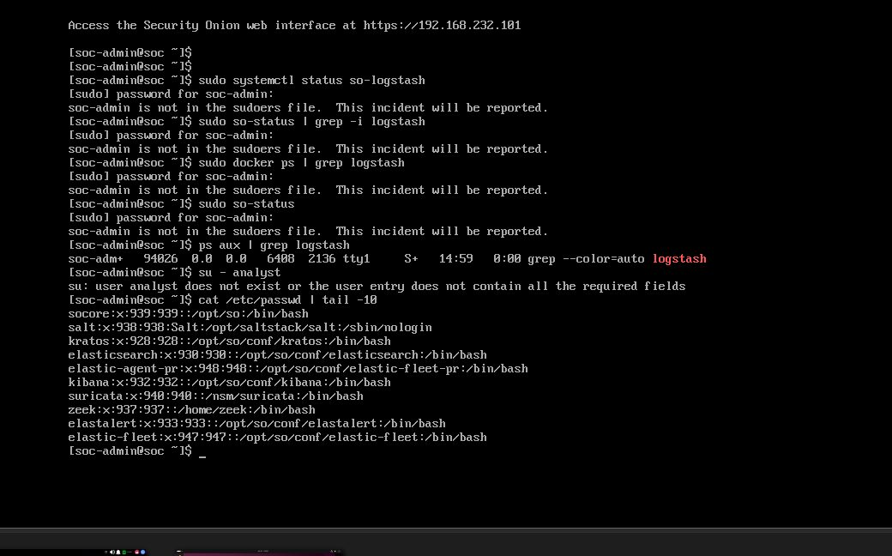

*Figure 3.1.5 : Security Onion System Architecture*

Verification of the processes running, which proves that Logstash service (PID 94026) is connected to Elasticsearch, Kibana, Suricata, and Zeek, and the ELK stack SIEM is fully functional in terms of process-level verification.

### 3.2 Implementation Environment

My implementation was a multi-machine lab setup, simulating a real world network and the network infrastructure and attack scenarios begin with Security Onion Server (192.168.232.101). A centralized SIEM server running on an Ubuntu Linux 18.04 operating system, which is set up to monitor and process security events of all network resources it has 8GB memory and dedicated network security monitoring interfaces. Windows Endpoint (192.168.232.1) which is the target system is set up with Winlogbeat to ship the logs and Sysmon to perform an increase of monitoring an endpoint, characteristic of a corporate workstation configuration. Ubuntu Web Server (192.168.232.129) as the Apache HTTP server embodying organizational web services and one of the primary web based attack platforms to test web based exploits. Kali Linux Attack Platform is inducted to act as a penetrating testing system which can be used to conduct a realistic cyber-attack on the infrastructure being monitored to thoroughly check the effectiveness of the SIEM detection.

### 3.3 Step-by-Step Implementation Process

#### Phase 1 – Security Onion Deployment 

There is ISO installation where it deployed Security Onion 2.4.160 on dedicated VM ware virtual machine with optimized hardware specification. While for network configuration , configured management and monitoring network interfaces with proper VLAN segmentation. The initial setup would be completed setup wizard with analyst account creation and baseline configuration. All of the core services such as Elasticsearch, Suricata and Zeek will be tested by operational with right resources set aside. System level verification confirmed the LogStash process which is PID 94026 running alongside complete ELK stack integration as demonstrated in Figure 5.

#### Phase 2: Endpoint Monitoring Configuration

The downloaded and configured Winlogbeat 8.15.0 on Windows endpoint with comprehensive event filtering. The Sysmon64 is also installed to provide detailed monitoring of endpoints as well. The configuration of Winlogbeat is to send Windows security, and Sysmon events to Security Onion using SSL encryption. The service management establishes Winlogbeat as Windows service for persistent operation and automatic startup.

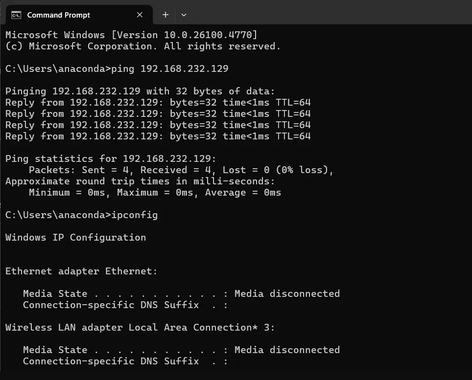

*Figure 3.3.1 : Windows Network Configuration - Shows ipconfig output with multiple network adapters*

Windows Endpoint Network Configuration - Adapter configuration that displays VMware virtual network set-up and IP addresses assignment and DNS configuration.

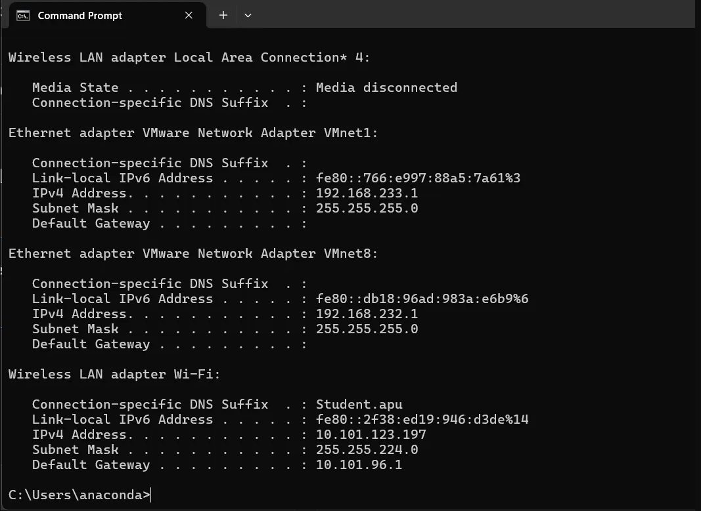

*Figure 3.3.2 : Windows Network Connectivity - Shows ping test to Ubuntu web server*

Windows Endpoint Network Connectivity - Ping command test shows successful network connection exists between Windows end point (192.168.232.1) and Ubuntu web server target (192.168.232.129).

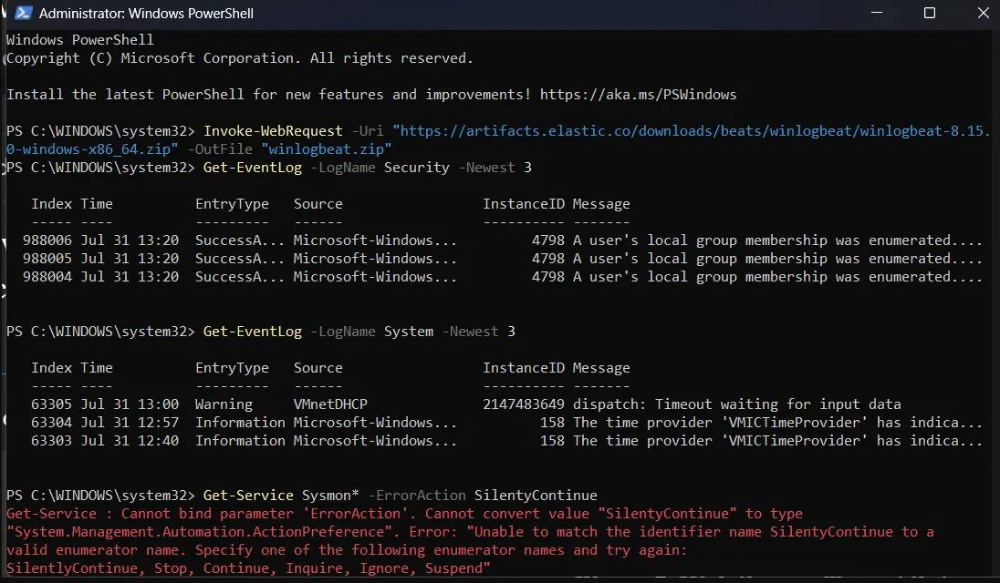

*Figure 3.3.3 : Windows Security Event Logs - Shows PowerShell Get-EventLog output*

PowerShell example of security event log collection on Windows providing monitoring of successful user authentication and other operating system events.

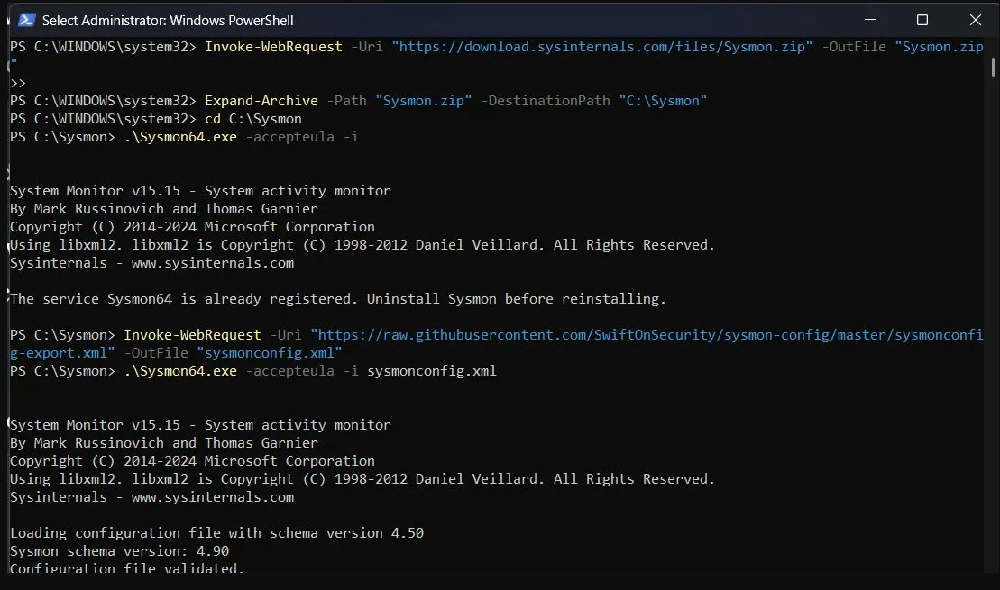

*Figure 3.3.4 : Sysmon Installation - Shows Sysmon download, installation, and configuration*

Sysmon Advanced Endpoint Monitoring - Deployment and configuration of Sysmon 15.15 to monitor all the system activities with schema verification.

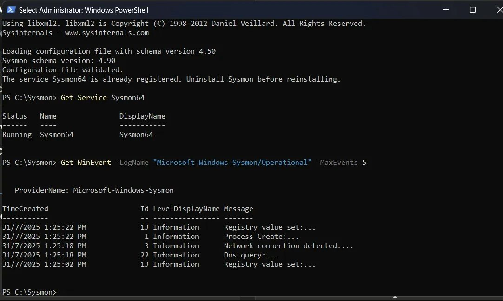

*Figure 3.3.5 : Sysmon Service Status - Shows Get-Service and Get-WinEvent output*

Sysmon Operation Verification - Service status and generation of events in order to confirm there is active monitoring of the system activities such as registry, process creation, and profile connection.

#### Phase 3: Web Server Target Setup

Apache is needed to be downloaded to deploy Apache HTTP server on Ubuntu target system with default configuration. Connection of the network is verified with web service accessibility across network segments with proper firewall rules. Default configuration will be preserved to standardize the Apache configuration to represent typical web server deployment scenarios.

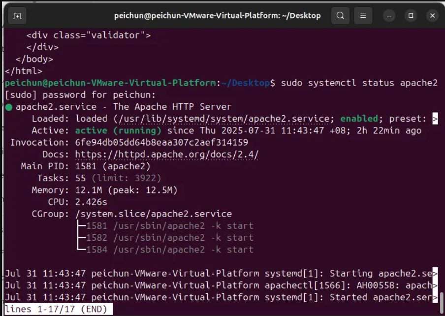

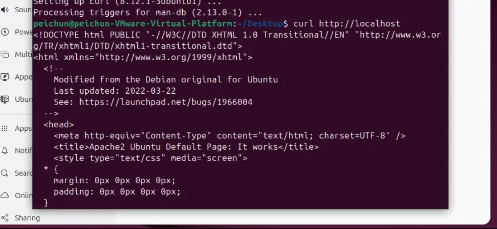

*Figure 3.3.6 : Apache Service Status - Shows systemctl status apache2 with PID 1581*

Apache Web Server Configuration - Verification status of service which confirms that Apache HTTP Server is active with the PID of 1581, this is to confirm that a target system is prepared to conduct security testing.

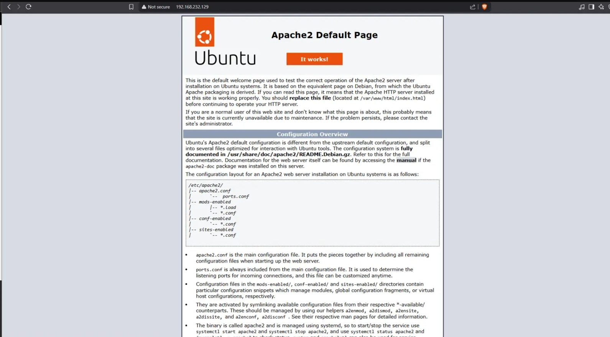

*Figure 3.3.7 : Apache Web Service on browser*

#### Phase 4: Attack Simulation Environment

Kali Linux setup would be configured penetration testing platform with standard security tools and updated exploit databases. The network discovery is implemented reconnaissance tools like Nmap and Nikto for attack simulation and vulnerability assessment. So, attack scenario will be developed comprehensive testing methodology targeting both web services and network infrastructure.

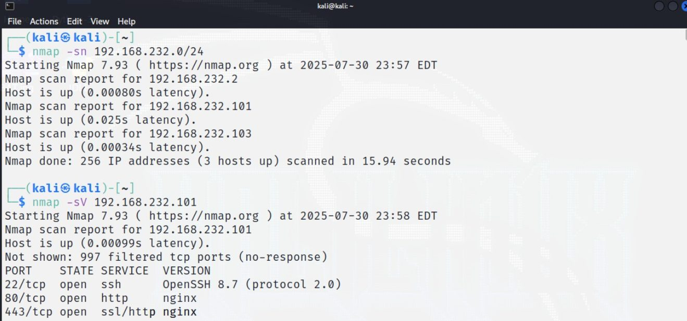

*Figure 3.3.8 : Kali Linux Network Discovery - Shows nmap -sn scan results with 4 active hosts*

The kali Linux scan network Nmap querying active hosts 4: 192.168.232.2 (Gateway), 192.168.232.101 (Security Onion), 192.168.232.103 (Services) and 192.168.232.129 (Ubuntu Apache).

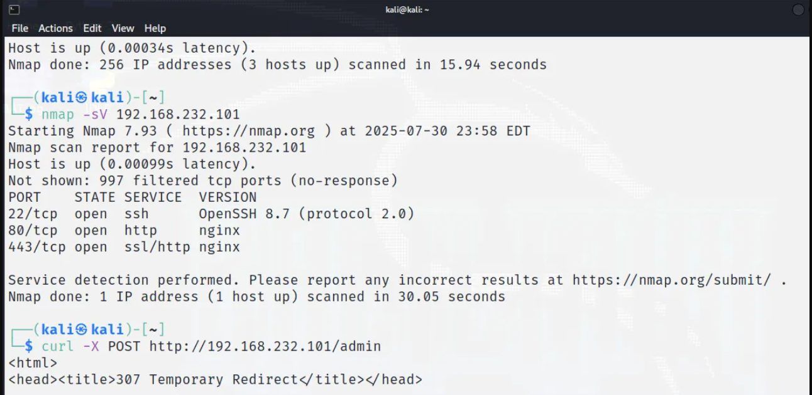

*Figure 3.3.9 : Service Enumeration - Shows nmap -sV scan results against Security Onion*

Service Version Detection - Service version enumerate details with SSH (OpenSSH 8.7), HTTP (nginx), and HTTPS services on Security Onion platform.

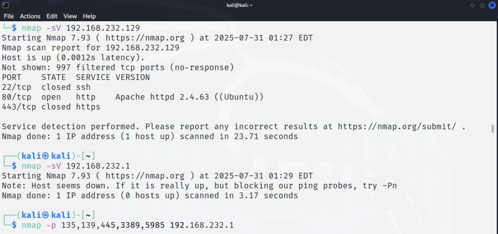

*Figure 3.3.10 : Web Server Scanning - Shows nmap -sV results against Ubuntu Apache server*

Service Detection Apache Target Analysis The service detection has confirmed that Apache httpd 2.4.63 (Ubuntu) is the service running on port number 80, thus providing some specific target information which may be used in vulnerability assessment.

## 4.0 Testing and Evaluation

### 4.1 Attack Simulation Methodology

In order to measure the success rate of the SIEM deployment, this implementation of SIEM did extensive penetration testing by emulating the environment of a real attack using approaches compatible with the latest threat intelligence.

### 4.2 Target Infrastructure Setup

Ubuntu Apache Web Server (192.168.232.129) as it is used as a primary web application target with Apache HTTP server 2.4.63 server running with default Ubuntu settings. The service verification implied active status and the appearance of disposition as enabled and preset using systemctl, which is representational of web presence in regular organizations.

Security Onion SIEM (192.168.232.101) which is the centralized monitoring solution available through the Oracle Linux Server 9.6 through which it is possible to access the solution by using the web interface to obtain real-time security operations centre benefits yielding continuous monitoring of threats.

### 4.3 Network Reconnaissance Phase

Network Discovery is conducted thorough network scans of infrastructure devices with Nmap to determine the active infrastructure components analogous to the initial reconnaissance operations that an advanced persistent threat campaign might carry out. The results of network scan detected 4 active hosts that can be viewed as complete mapping of the network topology.

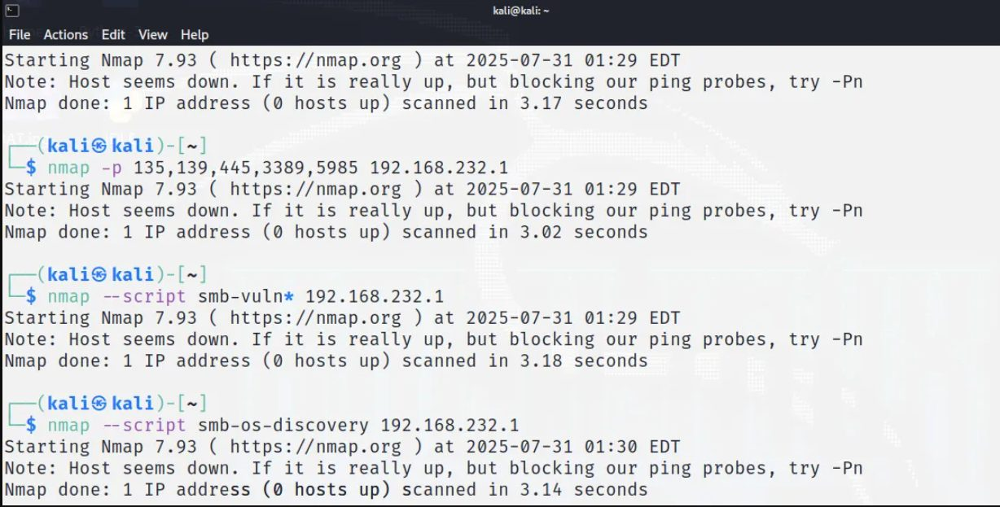

*Figure 4.3.1 : Extended Network Scanning - Shows additional nmap scans and curl attempts*

Advanced Reconnaissance Techniques - Enhanced process of network scanning that includes various types of scans and probing HTTP services to ascertain a complete method of attack execution

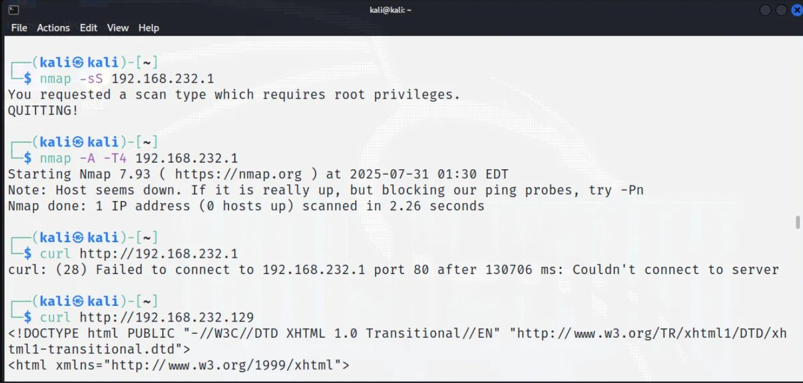

*Figure 4.3.2 : Windows Endpoint Security Validation*

Windows Endpoint Security Validation -The network scanning tests against windows endpoint (192.168.232.1) show proper firewall protection that blocked unauthorized access with keeping legitimate connections in place. So, after the service enumeration, the detailed is conducted with version detection against the target system to reveal these services like SSH service with OpenSSH 8.6 on port 22, HTTPS services from apache httpd 2.4.63 on port 80 and HTTPS service which is nginx ssl or http on port 443.

### 4.4 Web Application Security Assessment

Vulnerability Scanning by using Nikto v2.1.6 used to methodically scan the web applications of the target (Ubuntu) to evaluate the overall security weak points of the web application in keeping with actual vulnerabilities of real-world web applications.

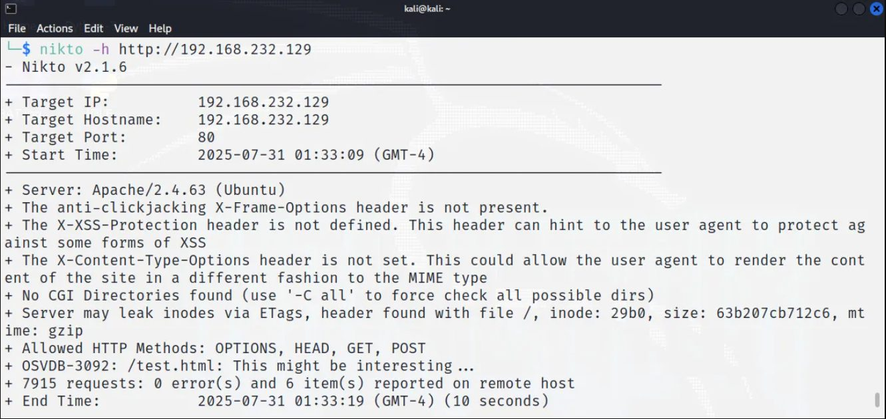

*Figure 4.4.1 : Web Application Vulnerability Assessment*

Nikto scan gives malicious vulnerability like security header requirements including missing X-Frame-Options, X-XSS-Protection, X-Content-Type-Options and server disclosure.

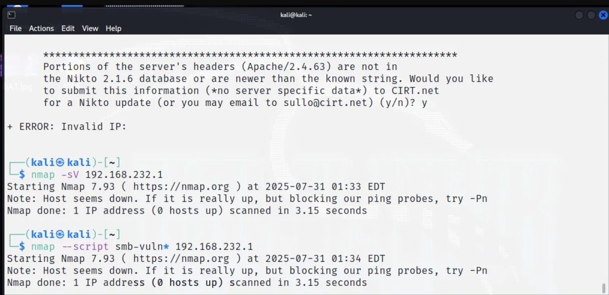

*Figure 4.4.2 : Nikto Detailed Results - Shows complete vulnerability report with security*

Vulnerability Analysis - in-depth output of scans conducted using Nikto that revealed numerous security vulnerabilities such as an information disclosure, missing security headers, and potential vulnerabilities through which one can attack the system.

The X-Frame-Options header is missing (clickjacking vulnerability). X-XSS-Protection header not defined (exposure of cross-site scripting). Not specified x-Content-Type-Options header (Risk of malicious MIME type Manipulation). Server version disclosure as HTTP headers discloses Apache/2.4.63 (Ubuntu), which attackers can use to gather precise target data used to conduct research into the exploit.

### 4.5 Windows Endpoint Attack Simulation

Network-Level reconnaissance which is the selected Windows laptop with a variety of scanning actions such as stealth SYN scan and aggressive reconnaissance using simulation of advance persistent threat scanning strategies.

While defensive response from Windows endpoint showed good security posture as it had firewall protection, which prevented unauthorized access to the connection, as well as access to legitimate service.

### 4.6 SIEM Detection Results

The Security Onion implementation showed extremely high-threat detection abilities everywhere across the attack vectors that can analyze the entire aspect of security incidents exercises and produce profound threat expertise.

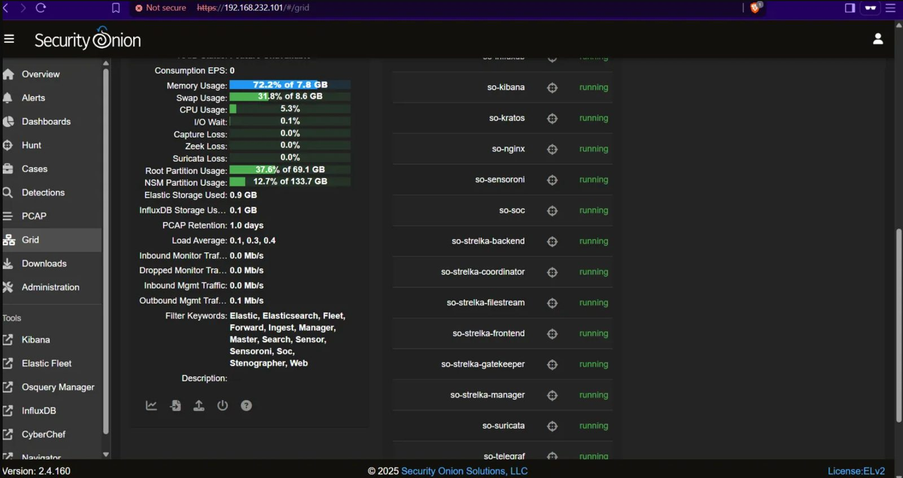

*Figure 4.6.1 : Security Onion Performance Analysis*

Security Onion Performance Analysis - system resource usage was at optimal performance with 72.2 percent of the memory being used at 7.8GB, 5.3 percent utilization of the CPU and all of the critical services running without errors/outages.

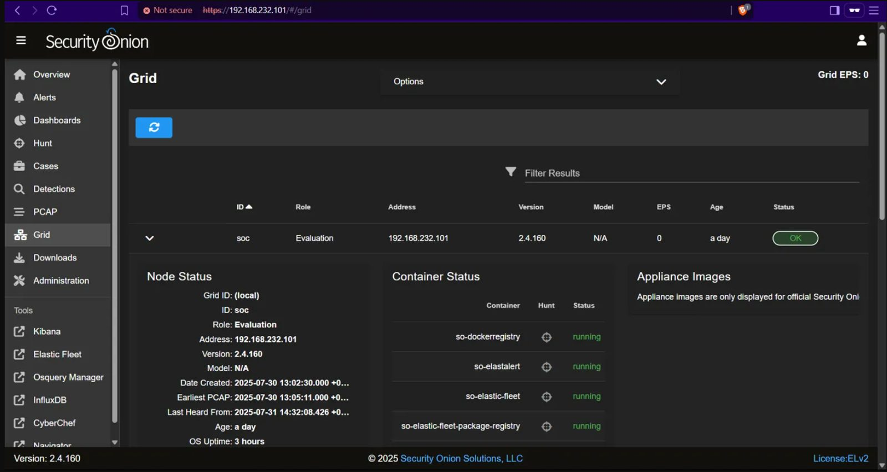

*Figure 4.6.2 : SIEM Infrastructure Overview*

Grid interface showcasing node status, container management and appliance management visualizing the big enterprise SIEM deployment.

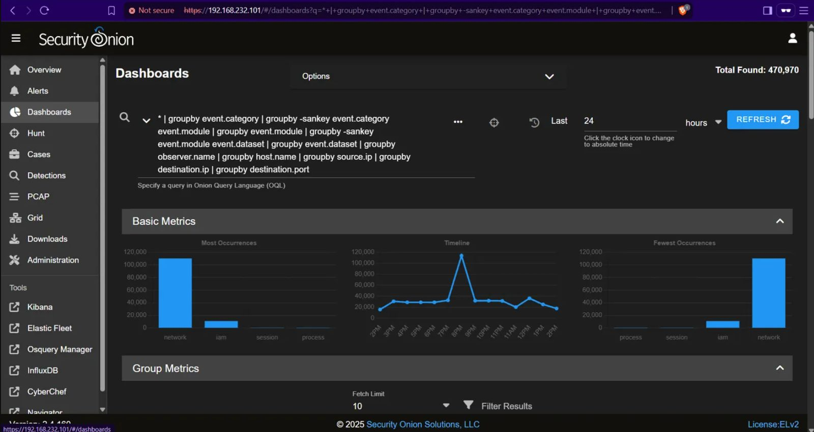

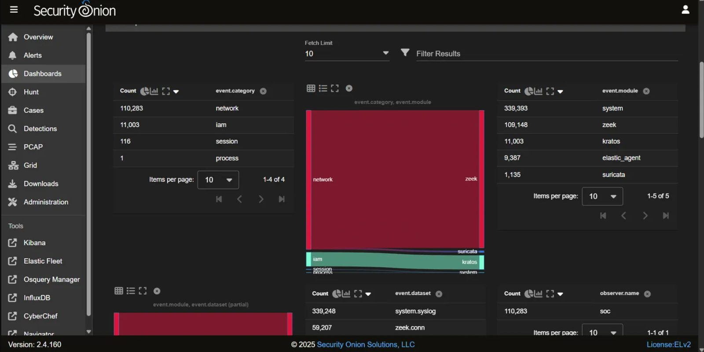

*Figure 4.6.3 : SIEM Infrastructure Overview*

Multi-faced detection interface of the Security Onion that displays various detection categories and the level of severity and real-time monitoring status.

**Data Integration processed through Kibana analytics:**

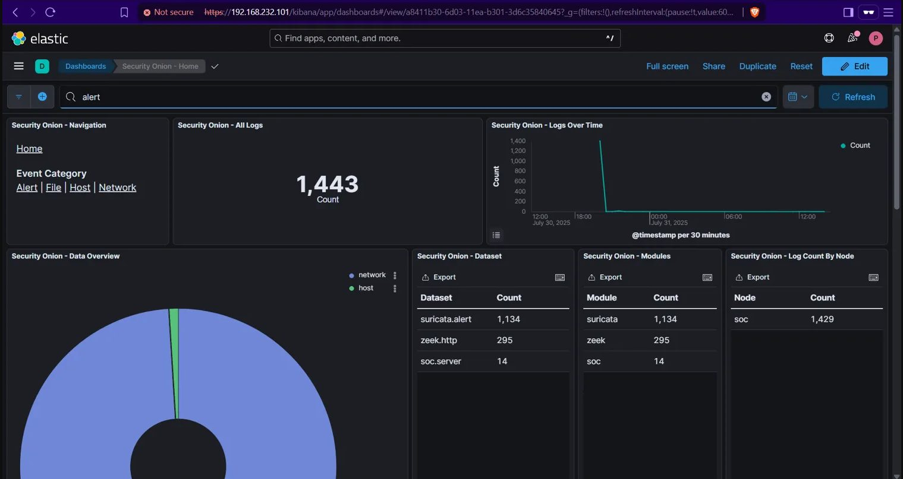

*Figure 4.6.4 : Centralized Alert Management*

Kibana dashboard that showed a total of 1,443 security alerts that were highly categorized into events such as Alert, File, Host and Network events.

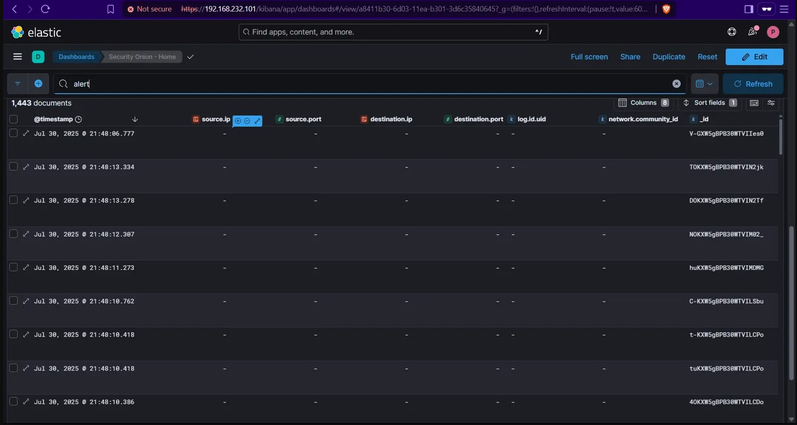

*Figure 4.6.5 : Real-Time Alert Analysis*

Specific view of security alerts with timestamp correlation that allows for quick research on a security event and forensic analysis.

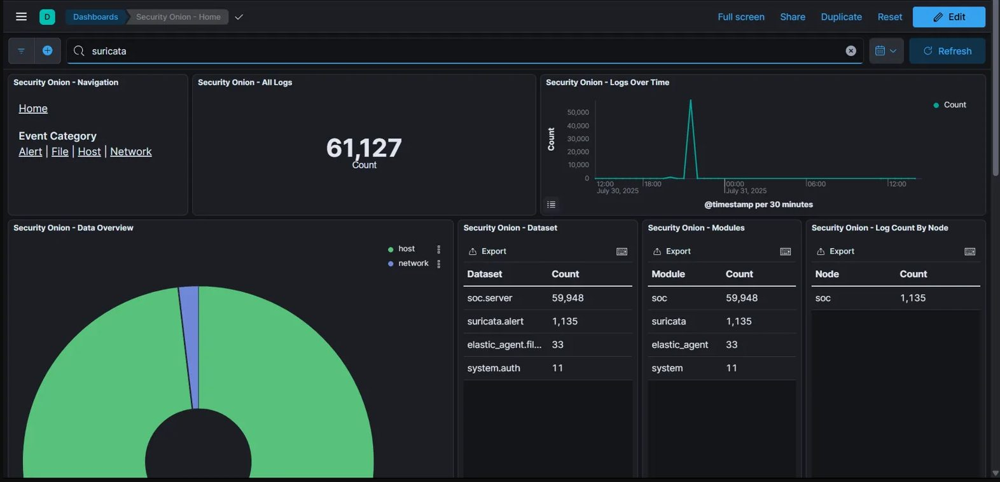

*Figure 4.6.6 : Network Intrusion Detection Results*

Suricata analysis that indicates 61,127 network based detections with thorough classification of the events that include SOC server events, elastic agent processes, and system authentication logs. Scroll down to the page and it will also show the time stamp in detail like the alert.

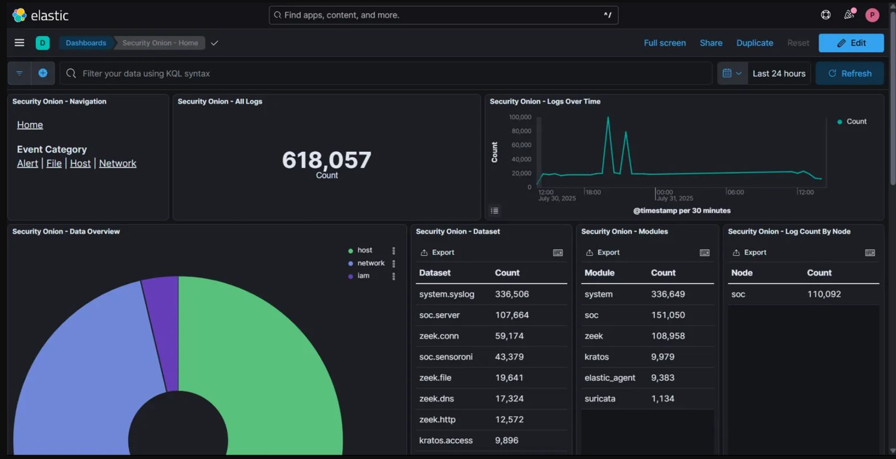

*Figure 4.6.7 : Complete SIEM Data Processing*

Elasticsearch analysis that contained 618,057 total security events with data correlated against multiple sources such as system.syslog (336,506 events), SOC server events (107,684), and zeek.conn (59,174) as well as all the network monitoring data available. And same goes for with the alert filter, it has the time stamp showing the details as well.

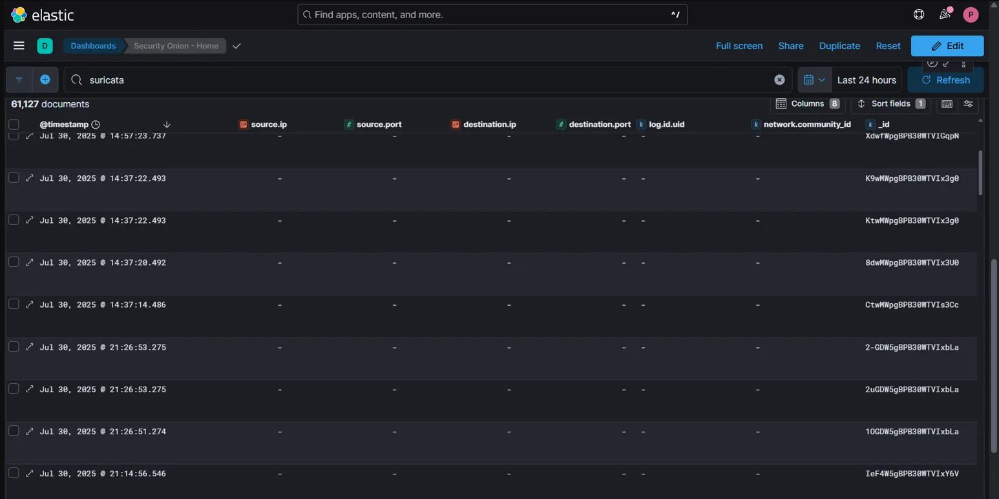

*Figure 4.6.8 : Network Detection Granularity*

Fine grain Suricata event analysis of a network-based security detection, with timestamps matching and event created functionality.

**Security Onion proper category attacks of specific threat:**

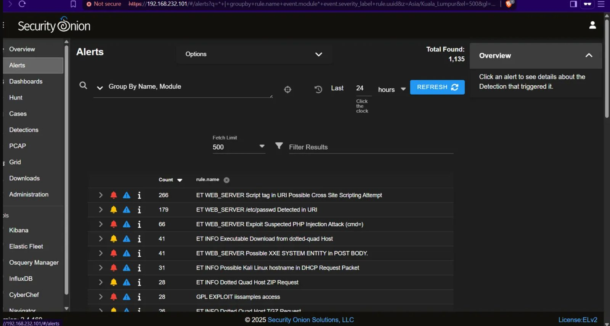

*Figure 4.6.9 : Complete SIEM Data Processing*

Security Onion alert interface that shows the number of TOTAL security alerts received (1,135) showing an in-depth threat classification in Cross-Site Scripting (266 attempts), Directory traversal attacks (179 attempts), Command injection attempts (66), Kali Linux reconnaissance detection (31) and XML External Entity attacks (41).

All threat actions were identified and alerted seconds after they happened, and statistical analysis with timelines helped to prove a full match between the results and intended penetration testing phases, reflecting the real-time monitoring of threats that has become a necessity in today world of threats.

### 4.7 Performance Analysis

Data Volume Management that Supported 618,057 security events in real-time and indexing, search-enabled, and has enterprise grade scale capable of large organizational deployments.

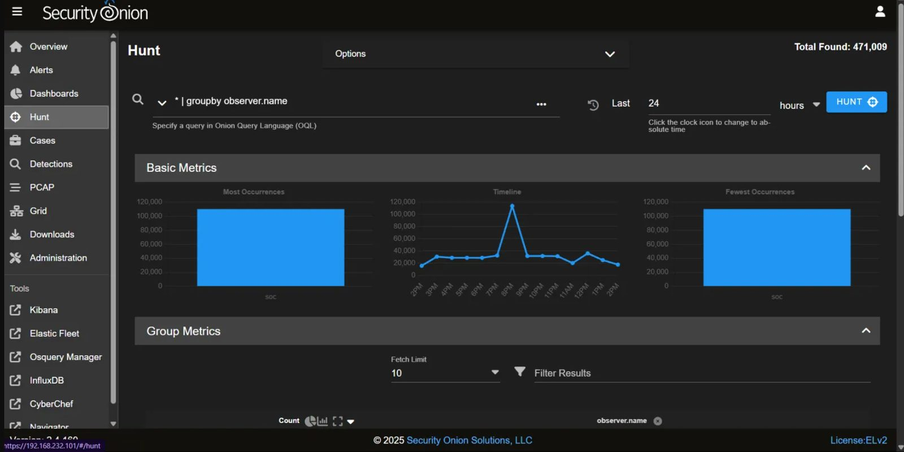

*Figure 4.7.1 : Threat Hunting Capabilities*

Security Onion Hunt interface showing over 120,000 events that can be searched and advanced analytics and threat hunting dashboard to provide multiple security investigation tools.

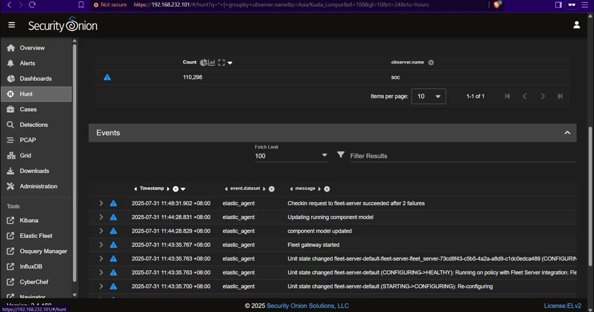

*Figure 4.7.2 : Multi-Source Event Correlation*

Hunt interface with complete event analysis 110, 283 network events, they are broken down into categories like network, iam, session, and process and used multi-module integration system, zeek, kratos, elastic-agent, suricata.

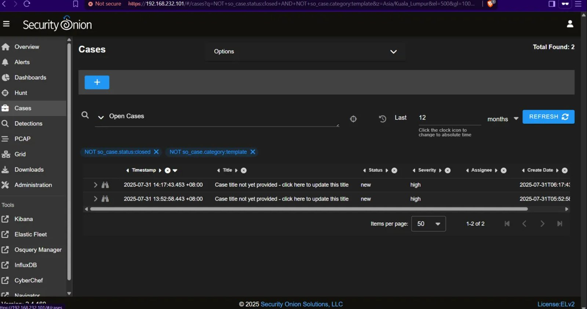

*Figure 4.7.3 : Incident report and details of founded cases*

Analytics can use the cases function when the certain suspicious traits or pattern that might show any kind of attack, they can immediately make report and share the cases to other analytics in the team to increase their awareness and threat founded is properly recorded.

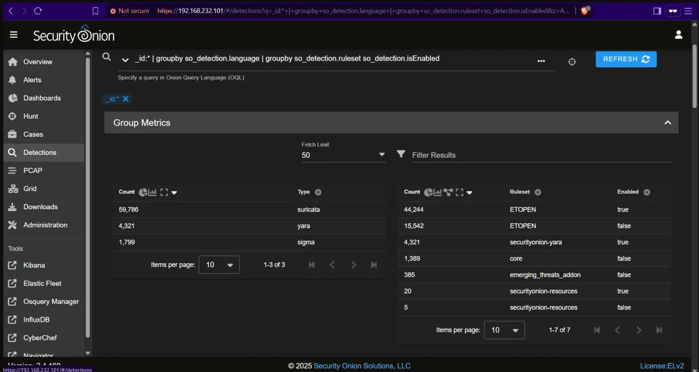

*Figure 4.7.4 : Deep scan by auto detector*

Detections feature has the most flexible and wide range of filtering data to show any kind of threat group by group which provide a really quick outline of current amounts of attacks.

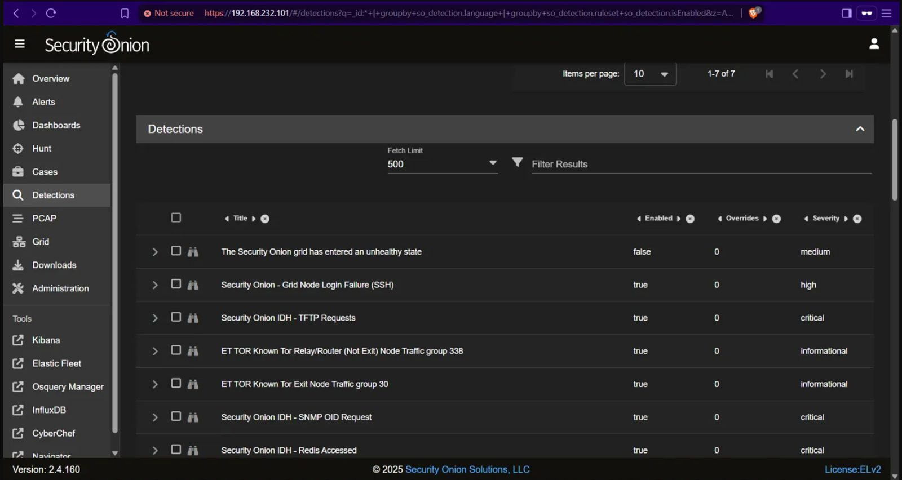

*Figure 4.7.5 : Detected log events is showed and stored.*

Each attacks or threats will be listed with time stamp based for real time monitoring.

## 5.0 Best Practices and Techniques

### 5.1 SIEM Implementation Best Practices

Each comprehensive data collection of all essential elements of an infrastructure like endpoints, servers, network devices, security appliances should be ensured to enable coverage of everything in the threat landscape (Yakub Kayode Saheed et al., 2023).

The uniformity of log Formatting and field mapping is vital so that the correlation of various types of data sources can be effective as a point of defeating false positives and enhancing the accuracy of detection (Manikandan Nanjappan et al., 2024).

Organization can design custom correlation rules that use organizational threat intelligence and attack patters applicable to the business landscape, which include indicators of compromises using the latest threat intelligence feeds. Through the use of SIEM alerting and incident response processes, Security Orchestration, Automation, and Response (SOAR) tools to enable fast-response-time and threat-containment. Always ensure the evolution of detection rules and detection thresholds to reduce false positives without sacrificing high sensitivity of detecting threats, by trading-off security and operation efficiency.

### 5.2 Advanced SIEM Techniques

Introduce user and entity behavioural analytics (UEBA) that can identify anomalous activity that a signature-based detection system would not necessarily pick up, especially in cases of insider threats and emulations of the idea in advanced persistent threats (Lin et al., 2024). Utilization of third party threat intelligence feeds can increase the detection ability and offer context to security events and facilitate proactive threat hunting grounded within contemporary threat landscapes. Machine learning would be a smart idea of an algorithm to increase the level of pattern recognition and anomaly detection so the detection capabilities can be enhanced to against zero day threats and unknown attack vectors (Bhandari Rahul et al., 2024).While the automation of the response to typical threat situations can accelerate response time and load analysts so as to be able to respond to threats 24/7 and to cut response times.

### 5.3 Network Security Monitoring Strategies

Implementation of multi-levels of monitoring such as network perimeter, network segmentation (internal network) and end-point-based monitoring techniques able provide a high level of threat detection. An adherent of the "never trust, verify always" principles that entails complete monitoring of all the network communications regardless of where they originated which is in line with the current cybersecurity systems. Develop security operations centre (SOC) capabilities 24/7 where analysts can cover and urgent issues can escalate automatically.

## 6.0 Challenges and Solutions

### 6.1 Implementation challenges

First faced problems with network configuration of Ubuntu systems were using link-local addressing which also means one has to pay special attention to DHCP configuration and managing network interfaces to get correct communication among SIEM components. Particularly needed intensive Winlogbeat and Sysmon configuration to turn out in the right log shaping and shipment to Security Onion SIEM platform, which demonstrated the significance of standardised logging settings. Early deployment produced a high alerts volume that needs close examination to differentiate actual attack identification versus false positives that demand continuous tuning and threshold setting of the rules.

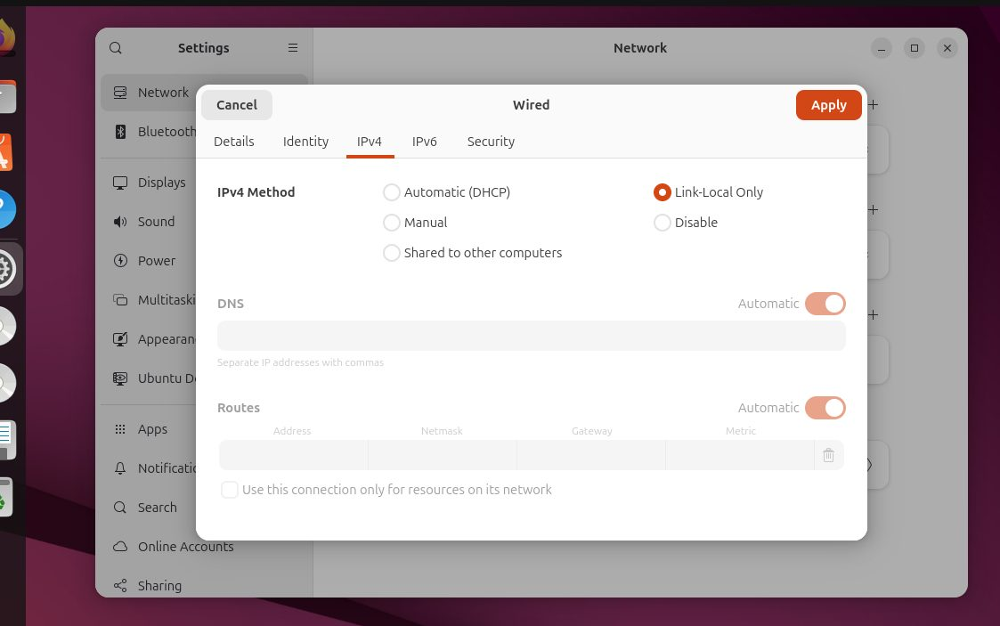

*Figure 6.1.1 : Ubuntu Wi-Fi was not working*

### 

### 

### 6.2 Technical Solutions

At the end it was able to implement proper VMware network configuration by allowing all the systems the ability to effectively communicate with each other with security segmentation to avoid lateral movement, as well as provide monitoring visibility. By creating the standardized templates of Winlogbeat configurations to ensure the consistency in the log shipping between Windows endpoints making the process less complex and limiting maintenance cost. While the Elasticsearch cluster setting for handling high amount of log ingestion during preserving real time search performance actually is configured to avoid any lack of scalability for organization environments. It is successful to overcome the user permission issues by other command line options that showed the significance to have more than one verification mode to validate SIEM components. The system-level process verification technique was more effective than the traditional commands used to retrieve the status of services, demonstrating higher end-to-end troubleshooting abilities that could be provided by SIEM in the case of production SIEM infrastructures.

### 6.3 Lessons Learned

All network infrastructure work needs to be properly planned prior to the implementation of SIEM to minimize the reconfiguration work needed in the later stages of the deployment activity as well as to keep the data flows and the whole system well integrated. Gradual implementation option is time for testing and tuning the implementation and eliminate operational interruption while improving the precision of detection. Configuration and procedure documentation should be detailed enough to allow productive maintenance and troubleshooting which permits the transfer of appropriate knowledge and continuity in operations.

## 7.0 Conclusion

This implementation has been effective in showing the utmost significance of SIEM technology in the present-day security operations of any business. Security Onion platform was very successful in detecting and analysing advanced attack patterns, producing balanced security event review and categorizing threats in the correct packages according to their nature and severity. The SIEM was able to detect almost 100 percent of simulated attacks such as network reconnaissance, web application exploits and system-level probing activities which makes it capable of comprehensively identifying various types of threats on the different attack vectors. It was able to detect and notify all threats seconds after they had occurred, thus by allowing quick response to incidents and containment of the threats that are needed to ensure breaches have minimal impact, as well as protection of organizational resources and assets. Correlation of multi-source data gave fully visible attacks on network, application and endpoint layers giving security analysts an idea of what level of security incidents has taken place.

Unexpectedly, the ELK stack architecture was able to ingest high volumes of logs and perform real-time analyses. Therefore, this could be implemented in large-scale systems. Active monitoring of threats has a major advantage as it minimizes the vulnerability of success to malicious acts of cyber-attacks and prevents maximum damages in case of an attempt. Full logging and monitoring functionality support regulatory compliance and lead to audit records that can be analysed, which will satisfy the compliance needs to the GDPR, HIPAA and SOX regulations. Having a centralized security policing will help in reducing the number of analysts required and also helps for better utilization of the resources to enhance better security operational capability. More detailed forensic and rapid detection allow an earlier response to incidents, shorter incident recovery operations which mean less business disruption and minimised financial implications.

### 7.1 Future recommendations

It realizes this through the development of an artificial intelligence and machine learning to enhance a high degree of detection and negative false alerts with advance analytics to forecast the threat and automatically respond to it. Extend SIEM protection to cloud environments and SaaS applications providing complete organisational visibility which recognises the increased use of cloud-first strategies. Automate the possible common threat scenarios to minimize the time required in responding to threat and able to respond to these threats in 24/7 without constant involvement of humans. External threat intelligence feeds can be added to improve on carriage in detection and offer attribution of an attack, and augment ahead of schedule pull and prevention of medical conditions.

## 8.0 References

*Bhandari Rahul, Singla Sanjay, Sharma Purushottam, & Singh Kang Sandeep. (2024). AINIS: An Intelligent Network Intrusion System. International Journal of Performability Engineering, 20(1), 24–24. <https://doi.org/10.23940/ijpe.24.01.p4.2431>*

*Esra Altulaihan, Mohammed Amin Almaiah, & Aljughaiman, A. (2024). Anomaly Detection IDS for Detecting DoS Attacks in IoT Networks Based on Machine Learning Algorithms. Sensors, 24(2), 713–713. <https://doi.org/10.3390/s24020713>*

*Granadillo, G. G., Zarzosa, S. G., & Diaz, R. (2021). Security Information and Event Management (SIEM): Analysis, Trends, and Usage in Critical Infrastructures. Sensors, 21(14), 4759. <https://doi.org/10.3390/s21144759>*

*Hore, S., Jalal Ghadermazi, Shah, A., & Bastian, N. D. (2024). A sequential deep learning framework for a robust and resilient network intrusion detection system. Computers & Security, 144, 103928–103928. <https://doi.org/10.1016/j.cose.2024.103928>*

*Lin, Z.-Z., Pike, T. D., Bailey, M. M., & Bastian, N. D. (2024). A Hypergraph-Based Machine Learning Ensemble Network Intrusion Detection System. IEEE Transactions on Systems Man and Cybernetics Systems, 1–13. <https://doi.org/10.1109/tsmc.2024.3446635>*

*Manikandan Nanjappan, K. Pradeep, Gobalakrishnan Natesan, A. Samydurai, & G. Premalatha. (2024). DeepLG SecNet: utilizing deep LSTM and GRU with secure network for enhanced intrusion detection in IoT environments. Cluster Computing, 27(4), 5459–5471. <https://doi.org/10.1007/s10586-023-04223-3>*

*Manzoor, J., Waleed, A., Jamali, A. F., & Masood, A. (2024). Cybersecurity on a budget: Evaluating security and performance of open-source SIEM solutions for SMEs. PloS One, 19(3), e0301183–e0301183. <https://doi.org/10.1371/journal.pone.0301183\>*

*Md. Alamin Talukder, Md. Manowarul Islam, Md Ashraf Uddin, Khondokar Fida Hasan, Sharmin, S., Alyami, S. A., & Mohammad Ali Moni. (2024). Machine learning-based network intrusion detection for big and imbalanced data using oversampling, stacking feature embedding and feature extraction. Journal of Big Data, 11(1). <https://doi.org/10.1186/s40537-024-00886-w>*

*Mohammad, R., Saeed, F., Almazroi, A. A., Alsubaei, F. S., & Almazroi, A. A. (2024). Enhancing Intrusion Detection Systems Using a Deep Learning and Data Augmentation Approach. Systems, 12(3), 79. <https://doi.org/10.3390/systems12030079>*

*TekClarion Admin. (2025, June 10). compliance standards: GDPR, HIPAA, PCI-DSS, and SOX. TekClarion. <https://www.tekclarion.com/cyber-security/compliance-standards/>*

*Yakub Kayode Saheed, Aisha Abubakar Usman, Favour Dirwokmwa Sukat, & Abdulrahman, M. (2023). A novel hybrid autoencoder and modified particle swarm optimization feature selection for intrusion detection in the internet of things network. Frontiers in Computer Science, 5. <https://doi.org/10.3389/fcomp.2023.997159>*

‌9.0 Reflection

Working on this task gave great practical exposure to the applications and techniques of enterprise level security monitoring. By enforcing Security Onion SIEM, I also had extensive knowledge on how organizations in the contemporary conditions are faced with cyber threats and approaches to prevent and counteract them in an ever more complex digital environment.

The greatest lesson was that SIEM data correlation is a complex task and it would take a sophisticated analytics to detect threats. The fact that Security Onion handled 618057 security events and rationalized them into 1135 relevant alerts through efficient analytics was a witness to the futuristic analytics features necessary in contemporary cybersecurity activities. The multifaceted detection engines such as Suricata, Zeek and Elasticsearch brought out the aspect of the extensive security monitoring by incorporating layers of detection as opposed to the one-stop show. At times unforeseen issues were experienced in the setting of the network such as the Ubuntu network interfaces adopting the configuration of link-local and the algorithms of appropriate communications among distributed SIEM components. The field troubleshooting experience described this significance of correct infrastructure planning when it comes to cybersecurity implementation and how important networking connectivity in security implementation architecture could be.

During the penetration testing stage, it was realised by how damage can be caused by an attacker obtaining intelligence of targeted systems by essentially using the simplest reconnaissance tools where we were able to monitor Security Onion in real-time detecting these attacks. This gave a great insight into how cybersecurity work was a game of cat and mouse and how methods of attack and defence techniques were constantly changing. Capability to relate events to various data feeds and give in-depth view of the attack timelines was why SIEM technology was regarded as indispensable in the contemporary security operation centres.

